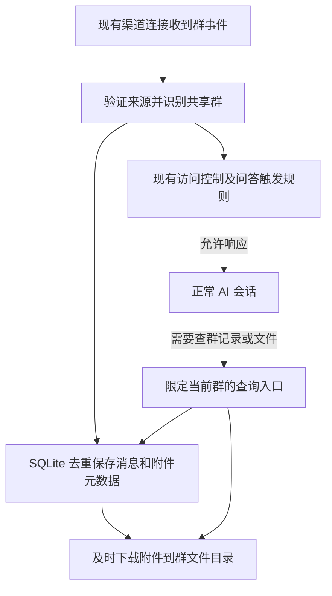

# Issue #295：六渠道群消息与群文件共享存储方案

> 状态：基础实现已完成，WhatsApp「test」群、飞书「DeepSeek大会」群及 QQ「梁子来了」群的文字与文本附件保存、读取流程已实测通过；Telegram「DSH 测试群」未 @ 普通文字保存及 @ 后读取已通过，文件暂未验收；Discord、Slack 尚未做真实账号验收。QQ 结论针对已授权查看全部群对话的 winBot，跨应用共享仍待验证。详见[实施与实测记录](./Issue-295-群记录实施与WhatsApp实测记录.md)。
>
> 日期：2026-10-18。源码核对基线：dsh-im 5.0.3，提交 `d9df48bd`。
>
> 关联问题：[Issue #295](https://github.com/xmanrui/dsh-im/issues/295)。本方案更新了此前讨论中的数据归属、存储方式、渠道范围和保留期限。

## 1. 已确定的方向

本期只考虑 **WhatsApp、飞书、Telegram、Discord、Slack、QQ**，暂不考虑 Matrix、钉钉、企业微信等其他渠道。

- 群聊天记录、群文件属于群，独立于机器人、AI 会话和 Harness 工作区。
- 同一个群只保存一份记录。在该群中 @ 任意已接入且获准响应的机器人，都能读取同一份本地群记录和文件。
- 未 @ 的消息只采集、保存，不因此触发模型、创建 AI 会话或回复群成员。原有问答触发规则继续生效。
- 平台实际投递的群消息及附件默认自动保存，无需先 @ 发现群或逐群开启；通用设置只配置保留天数。
- 使用 **一个插件独立的 SQLite 数据库 + 一个群文件目录**，不复用 Harness 会话存储。
- 保留期限以天数为准，默认滚动保留最近 **14 天**，可在插件全局设置中修改；不设置按群、按机器人覆盖值。
- 实现保持简单：复用现有连接和文件下载能力，不引入向量库、搜索服务、对象存储、消息队列服务或分布式采集系统。

旧文档 [WhatsApp 群聊记录与按日总结方案](./WhatsApp群聊记录与按日总结方案.md) 中“复用 Harness 会话存储”“按机器人和工作区划分记录”“不自动删除过期记录”等设计由本文替代。

## 2. 六个渠道的支持情况

这里的“支持”指平台或当前 SDK 提供采集路径，**不等于所有账号、权限环境都已实测通过**。下表的“当前代码与最小改动”以实施前基线为准，实际落地见实测记录。群文件在本期指“实际收到的群消息所附带的文件”，不包含自动遍历平台整个群文件库。

| 渠道 | 获取未 @ 群消息的条件及来源 | 群消息附件的获取方式 | 当前代码与最小改动 |
| --- | --- | --- | --- |
| WhatsApp | **可行，基于当前 Baileys 关联设备接入。** 登录账号在群内时，通过 `messages.upsert` 收到群消息，接收不以 @ 为前提。 | 从消息内的媒体信息调用 Baileys `downloadMediaMessage`，保存图片和普通文件。应及时下载，不能只存远程引用。 | 已有群消息归一化、图片和文件来源；在响应过滤之前增加归档分支。当前关闭完整历史同步，保留这一行为。 |
| 飞书 | **有条件支持。** 使用应用机器人，机器人入群，订阅 `im.message.receive_v1`，获批 `im:message.group_msg` 等所需权限后接收普通群消息。只有 @ 消息权限时不够。[飞书权限依据][feishu-history] | 用收到的 `message_id` 和资源 `file_key`，通过消息资源下载接口获取文件；使用有权访问该消息的应用凭据。 | 已有群消息权限管理及资源下载；归档放在 `bridge.accept()` 的提及过滤之前。无需把“群回复模式”改成所有消息都回复。 |
| Telegram | **有条件支持。** Bot 入群，关闭 Privacy Mode，或作为群管理员；通过现有 Bot API 更新接收群消息。关闭隐私模式后需重新加入已有群。其他 Bot 消息另受 Bot-to-Bot Communication Mode 等条件约束，本期不自动启用。[官方说明][telegram-privacy] | 消息携带 `document`、图片等文件信息，通过 `getFile` 下载。云端 Bot API 当前下载上限为 20 MB；超限只能记录元数据及失败原因。[下载说明][telegram-faq] | 已归一化普通群消息及附件，但未寻址消息会被公共桥接器过滤；在此之前采集即可。无须引入用户账号客户端或自建 Bot API 服务。 |
| Discord | **有条件支持。** 范围是服务器内机器人有权访问的文字频道及线程。需要消息事件 Intent 和有效的 `MESSAGE_CONTENT` 权限；否则未 @ 消息的正文、附件字段可能为空。[官方说明][discord-intents] | 从 `MESSAGE_CREATE` 的 `attachments` 取得资源并及时下载。缺少内容权限会同时影响文件获取。 | 已请求相关 Intents、处理消息事件并支持附件下载；仍需平台后台启用/获批相应权限。增加静默归档，不能把空正文误判为完整采集成功。 |
| Slack | **有条件支持，需补订阅。** Bot 加入目标公开/私有频道，配置 `message.channels` / `message.groups` 和对应 `channels:history` / `groups:history`。本期先覆盖这两类频道。[公开频道][slack-public]、[私有频道][slack-private] | 从消息的 `files` 获取元数据，用带 `files:read` 的 Token 下载 `url_private` / `url_private_download`。元数据不完整时复用现有补查；外部云文件不保证可下载。[官方说明][slack-files] | 当前 Manifest 已含相应历史与文件权限，但只订阅 `app_mention`、`message.im`；归一化也只接受这两类。需要同时扩展订阅和归一化，并按原始消息 ID 去重。已有安装需更新事件订阅，权限变更时重新授权。 |
| QQ | **条件性支持，必须实测确认。** 当前官方 SDK 能处理 `GROUP_MESSAGE_CREATE` 和 `GROUP_AT_MESSAGE_CREATE`；公开群消息文档明确列出的是 @ 事件。SDK 支持某事件不代表所有账号都会收到未 @ 消息。[SDK][qq-sdk]、[公开事件文档][qq-events] | 若实际事件携带 `attachments` 及可用下载地址，可复用现有下载器保存图片、语音、视频、文件。普通文件是否在未 @ 场景下投递，需与文字消息分别验证。 | 保留对未 @ 事件的适配；先用实际账号验证投递权限、普通文件和多机器人标识。不能把 QQ 全量群消息、历史群文件目录标为无条件支持。 |

说明：

1. WhatsApp 结论针对本项目正在使用的 Baileys 接入，不是对其他 WhatsApp API 产品的能力承诺。
2. “机器人能收到事件”“插件已保存文件”“模型能理解文件正文”是三件事。下载成功不代表已解析 PDF、表格、图片或语音。
3. 第一版从接入后实际收到的消息开始积累。飞书、Slack、Discord 即使另有历史查询接口，也不在本期做历史回填；不承诺入群前、接入前或离线期间的完整记录。
4. 群文件页里原有的文件、云文档链接、未投递的附件不自动导入。无法下载的附件保留名称和状态，不能向模型声称已读取正文。
5. 平台不提供的机器人发言、编辑或撤回事件无法补齐。第一版不建设完整的消息修订审计系统，也不将“已采集记录”描述为群的完整历史。

### 2.1 哪些渠道需要补授权或配置

| 渠道 | 在原有 @ 问答接入基础上需要补什么 |
| --- | --- |
| 飞书 | 原先只有 @ 消息权限时，需增量开通 `im:message.group_msg`，并完成飞书要求的发布/审批；仍订阅 `im.message.receive_v1`，机器人需在群内。下载用户消息附件还需 `im:message:readonly` 或该接口接受的等效消息读取权限，不能用上传资源权限 `im:resource` 替代。已有对应权限则无需重复申请。插件已支持单独授权群消息采集而保留原回复模式。 |
| Discord | 在开发者后台启用 **Message Content Intent**，符合验证条件的应用还需获批该特权 Intent；机器人需有目标频道访问权限。代码原已申请相关 Intent，无需为了此功能重新邀请已有权限的机器人。 |
| Telegram | 通过 BotFather 关闭 Privacy Mode 并重新入群，或使用已是群管理员的 Bot；这是消息接收设置，不是新增 OAuth 授权。普通成员消息与文件共用这条接收路径。 |
| Slack | 项目原 Manifest 已含 `channels:history`、`groups:history`、`files:read`，本次增加 `message.channels` / `message.groups` 事件订阅。已有应用需同步订阅；只有实际安装缺少所需 Scope 时才需要补 Scope 并重新安装授权。机器人仍需加入目标频道。 |
| WhatsApp | 当前 Baileys 关联设备方案无需新增 OAuth 权限；登录账号在群内且连接有效即可接收实际投递的群消息及附件。 |
| QQ | 需根据实际应用类型、开放能力及账号测试确认。已实测的「梁子来了」群此前已由群主授权 winBot 查看全部群对话，未 @ 文字及文本附件均可接收；不能据此保证其他应用默认支持。当前仅保存实际投递的事件，未投递的消息和文件无法靠本地存储补齐。 |

飞书消息事件及资源下载分别见[接收消息][feishu-receive]、[获取消息中的资源文件][feishu-resource]。插件默认采集实际收到的群事件，不能代替平台权限申请；平台未投递的消息和文件无法保存。

实现补充：飞书扫码新增和“补全权限”（含 `/repair`）现均申请 `im:message.group_msg` 与 `im:message:readonly`。授权完成后保存 `groupMessagePermissionGranted`，新机器人默认仅 @ 回复，已有机器人保留原回复方式；实际收到的群消息和文件默认自动保存。手动填写凭据不会被当成已完成这两项授权。

### 当前源码依据

| 范围 | 相关文件 |
| --- | --- |
| WhatsApp 事件、历史同步、媒体 | [whatsapp-web-session.mjs](../../src/channels/whatsapp/whatsapp-web-session.mjs)、[whatsapp-runtime.mjs](../../src/channels/whatsapp/whatsapp-runtime.mjs) |
| 飞书接收过滤、权限、资源下载 | [bridge.mjs](../../src/channels/feishu/bridge.mjs)、[group-message-permission-manager.mjs](../../src/channels/feishu/group-message-permission-manager.mjs)、[resource-download.mjs](../../src/channels/feishu/resource-download.mjs) |
| Telegram、Discord 事件与附件 | [telegram-runtime.mjs](../../src/channels/telegram/telegram-runtime.mjs)、[discord-runtime.mjs](../../src/channels/discord/discord-runtime.mjs) |
| Slack 订阅与事件筛选 | [manifest.mjs](../../src/channels/slack/manifest.mjs)、[slack-runtime.mjs](../../src/channels/slack/slack-runtime.mjs) |
| QQ 事件与附件 | [qq-runtime.mjs](../../src/channels/qq/qq-runtime.mjs)、[qq-bridge.mjs](../../src/channels/qq/qq-bridge.mjs)，依赖 `@tencent-connect/qqbot-nodejs@1.0.4` 的事件分发器 |
| 公共未寻址消息过滤 | [text-harness-bridge.mjs](../../src/channels/shared/text-harness-bridge.mjs) |

## 3. 按群共享与去重

### 3.1 群标识

归属使用 `渠道 + 平台命名空间 + 平台群标识`，在库内对应一个 `group_id`。平台命名空间只用于区分平台租户、服务器或 Slack 团队，不使用 Harness 工作区 ID，也不使用机器人 ID。

| 渠道 | 群归属与线程处理 | 消息去重依据 |
| --- | --- | --- |
| WhatsApp | 群 JID | 群 JID 内的原始 `key.id` |
| 飞书 | 飞书/Lark 域 + `chat_id`；话题作为消息字段。不能用发送者的 `tenant_key` 划分群，否则外部成员会把同群拆开 | `message_id` |
| Telegram | `chat.id`；论坛 Topic 存 `message_thread_id`，不拆成不同群 | 群内 `message.message_id`，**不用 `update_id`** |
| Discord | `guild_id + channel_id`；线程按自己的频道 ID 保存，避免把私有线程自动混入父频道 | 原始消息 `id` |
| Slack | 平台 `team_id + channel`；`thread_ts` 作为消息字段 | 频道内 `event.ts`，**不用外层 `event_id`** |
| QQ | 平台群标识，当前来源为 `group_openid`；跨应用稳定性需实测 | 原始消息 `id`；跨应用一致性需实测 |

不能直接使用现有 AI 会话的 `conversationId`：例如 Slack、Telegram 会在里面拼接线程标识；也不能以事件投递 ID 去重，否则多个机器人或多种订阅可能重复保存同一条消息。

QQ 必须单独验证：同一实体群、同一条消息，两个不同应用收到的 `group_openid` 和消息 ID 是否一致。若为应用级标识，需要经核实的源标识到共享 `group_id` 的小型映射；机器人/应用只作为来源，数据仍归群所有。**未验证前不承诺 QQ 跨应用自动共享，也不按群名、发送时间或正文猜测合并。** 若没有可靠映射或稳定去重依据，先限制为一个采集来源，跨应用共享标为待支持，不阻塞其他渠道。

其他渠道也应通过双机器人样例确认标识稳定性；本期不建设跨平台群合并或通用身份系统。

### 3.2 多机器人行为

- 同群同消息写入使用唯一约束；同一消息附件也使用唯一约束，避免重复下载。重复投递可以补齐缺失的文件元数据，但不能因先收到的事件缺少附件就永远忽略后续完整事件。
- 机器人 A 收到普通消息并保存后，机器人 B 即使只收到 @ 请求，也可以在确认请求来自同一群后读取本地共享记录。
- 更换机器人、删除机器人、执行 `/new`、切换 AI 会话或工作区，都不删除或迁移群记录。
- 共享范围限定在同一个 DSH 数据目录、同一插件实例的数据中，不做不同机器之间的同步。
- 群内当前请求及已有访问控制决定能否读取。模型不能凭自己填写的群 ID 读取其他群；附件也必须校验所属群。

## 4. SQLite 与文件目录

统一放在插件公共数据目录，不分散到各渠道、各机器人的目录。路径沿用现有全局设置的 DSH Home 解析规则：配置的 `dshHome` → `DSH_HOME` → `~/.dsh`。

```text
<DSH_HOME>/integrations/dsh-im/
  general-settings.json           # 新增的通用设置，包含保留天数
  group-history.sqlite           # 六渠道共享数据库
  group-files/
    <内部 group_id>/
      <内部 message_id>/
        <内部 attachment_id>     # 文件本体；原始文件名保存在数据库
```

上述文件由本次实现新增；`general-settings.json` 在首次保存设置后写入，缺失时使用默认 14 天。已有 `settings.json`（入站附件 TTL）与 `image-input-settings.json` 继续承担原来的用途。

### 4.1 三张表即可

| 表 | 最小字段 | 作用 |
| --- | --- | --- |
| `groups` | `id`、`channel`、`platform_scope`、`platform_group_id`、`name`、`recording_started_at` | 群身份及开始保存时间；不包含 `bot_id`、`session_id`、`workspace_id` 作为归属字段 |
| `messages` | `id`、`group_id`、`platform_message_id`、`sender_id`、`sender_name`、`sent_at`、`received_at`、`type`、`text`、可空的 `thread_id` / `reply_to_message_id` | 一条平台消息一行，姓名保存收到时的快照，保留正文中的提及和文本，不使用专门为 AI 去掉 @ 的正文作为唯一原文 |
| `attachments` | `id`、`message_id`、`source_attachment_key`、`name`、`mime_type`、`size_bytes`、`relative_path`、`status`、`last_error` | 一条消息可有多个附件；只存元数据，文件本体不放 SQLite BLOB |

约束和索引保持最少：

- `groups`：唯一 `(channel, platform_scope, platform_group_id)`；命名空间无值时统一为空字符串。
- `messages`：唯一 `(group_id, platform_message_id)`，索引 `(group_id, sent_at, id)` 和清理用的 `sent_at`。
- `attachments`：唯一 `(message_id, source_attachment_key)`，消息外键；无稳定附件 ID 时使用该消息内稳定的附件位置。
- Telegram 的 `file_id` 属于接收它的 Bot，不能直接作为跨机器人附件去重键；采用稳定的 `file_unique_id` 或消息内附件位置，下载时使用实际接收连接的 `file_id`。文件落盘后其他机器人直接读取共享原件。[平台说明][telegram-features]
- 时间保存为 UTC 毫秒；平台时间缺失时明确回退到收到时间。查询“今天”等自然日时先按请求采用的时区转换范围。
- 不存独立的 `expires_at`，每次根据当前全局天数计算截止时间，使修改天数直接作用于已有记录。

数据库由一个共享服务持有，小批量事务写入，启用外键；使用 WAL 和有限的锁等待。当前项目要求 Node `>=22.19`，优先采用内置 `node:sqlite`，避免额外原生依赖和 ORM；该模块在此 Node 版本仍标为开发中，实施时需验证目标运行时与打包结果。[Node 文档][node-sqlite]

SQLite 删除记录后空间可复用，数据库文件不一定立即变小；第一版不按每次清理执行全库 `VACUUM`。

### 4.2 群文件的保存

复用各渠道“取得可下载资源/下载流”的部分，目标改为群文件目录，不能复用会话工作区作为原件的存储位置。

1. 先写入消息和附件元数据；附件状态为 `pending`。
2. 收到后尽快下载，使用少量并发，例如 2 个任务，不等待用户 @ 后才开始。
3. 写临时文件，完成后原子改名并标记 `ready`。路径使用插件生成的 ID，原始文件名只用于展示。
4. 失败、链接过期、超出平台限制分别标记 `failed` / `unavailable`，保留可读原因；不把半个文件标记为成功。
5. 设置下载超时及流式大小限制，不能只相信平台声明的文件大小。第一版建议采用一个内部统一上限（例如 100 MiB），实际还受 Telegram 等平台更低的限制，不新增一组复杂设置。
6. 不保存 Token、带 Token 的下载 URL 或完整敏感原始事件。当前连接用于下载；下载后的文件不依赖原机器人继续存在。

简单处理重启：未完成的下载不假装成功，重启后识别 `pending` 和临时文件；能通过仍有效的资源引用重新获取时有限重试，不能恢复时标记不可用。无需引入持久化任务队列服务或无限重试机制。

不做跨消息文件内容去重，每个消息附件保存一份。这样过期删除只处理它所属的消息，不需要额外引用计数系统。WhatsApp 阅后即焚等特殊媒体不新增绕过其语义的归档能力。

## 5. 设置页面与保留规则

### 5.1 页面位置

实际入口为：**DSH 设置 → IM机器人 → 右上角齿轮「通用设置」**。这里的“全局”指 dsh-im 所有渠道共用，不是 Harness 宿主的通用设置页。

在现有页面中增加「通用」Tab，保留已有「附件」Tab：

```text
通用设置
  [通用] [附件]

  群聊天记录保留天数    [14] 天    [保存]
  保留最近 N 天的群聊天记录及其附件，超过期限后自动清理。
```

- 字段名建议为 `groupHistoryRetentionDays`，默认 `14`，接受正整数。
- 第一版不增加永久保留、按条数保留或群级覆盖选项。
- 保存后无需重启，对所有群生效。调小会使部分已有记录过期；调大不能恢复已经删除的内容。
- 本方案为减少配置，**建议群文件跟随关联消息使用同一保留天数**，不另设文件保留期限。
- 已有「附件」Tab 的“附件保留时长（小时）”继续管理原有会话入站附件，不负责群文件原件；不能让旧清理器提前删除群文件。

建议新增配置文件内容：

```json
{
  "version": 1,
  "groupHistoryRetentionDays": 14
}
```

群采集默认开启，不设逐群开关或已发现群列表。收到第一条有效群消息时即登记共享群身份并保存消息及附件，无需先 @ 机器人。旧版数据库可能保留 `enabled` 列，升级后忽略该列，不删除已有记录；曾关闭的群也按默认规则采集。

### 5.2 滚动清理

保留范围是最近 `N × 24` 小时，不是固定保留 N 个自然日。以消息发送时间计算截止时间，超过保留范围的迟到消息不重新入库。

- 启动时执行一次清理，此后每小时执行；缩短天数后异步触发一次。
- 查询和文件读取都实时应用截止时间，避免定时清理尚未运行时仍返回过期内容。
- 分批找出过期消息，删除其附件文件及元数据，再删除消息；文件不存在按已删除处理。删除失败时保留可重试记录，后续清理重试，不先丢掉文件路径。
- 文件下载和清理通过同一个服务协调。下载完成前再次检查消息是否过期，避免清理后迟到的下载结果重新留下孤立文件。
- 渠道断开后没有新事件时，原有记录仍按全局期限清理。保留群身份，不因消息全部过期而改变同群归属。
- 配置文件缺失才使用默认值；配置损坏时报告错误、暂停自动清理，不能擅自回退到 14 天删除数据。

本规则负责插件群记录库及群文件原件。已经提交给模型并进入 Harness 会话历史的消息副本、生成的总结和工作区文件副本，仍按它们各自的生命周期处理；不能宣称修改此项会清除所有副本。

## 6. 最小接入流程



归档在渠道的提及过滤、会话路由和 AI 文件预取之前接入，默认保存实际收到的群消息。不能只修改公共桥接器：飞书和 Slack 存在更早的过滤，QQ 还有独立桥接链路。

默认保存该群普通成员的实际消息，不意味着这些成员都能调用机器人；发起查询、运行模型继续使用现有请求者权限。采集失败要报告状态，但不应阻塞原有问答；文件下载不占住平台回调或群回复队列。第一版沿用平台现有重投递机制，不承诺断电瞬间消息零丢失。

实现只需要三个共同部分：

1. **存储服务**：群登记、消息/附件写入、去重、查询、文件下载协调和过期清理。每个 DSH Home 一份实例。
2. **轻量渠道转换**：从六种事件提取稳定群 ID、原始消息 ID、发送时间、正文及现有下载来源，送入同一个服务。平台差异留在已有渠道文件中。
3. **设置与读取入口**：复用 `/dsh-im-settings` 的管理 RPC 和现有插件工具注册方式，增加保留天数和当前群的记录/文件读取。

不建设独立采集进程，不按机器人建立数据库，不生成用于存放原始群聊的 Harness 会话。

## 7. 查询与模型上下文

保存 14 天数据，不代表一次向模型发送 14 天数据。

- 消息查询使用“当前群 + 时间范围 + 可选关键词 + 游标”，例如每页最多 100 条；响应同时限制字节数或 token 预算，并返回是否还有下一页。
- 附件随消息返回元数据，也可按当前群和文件名分页查找；需要正文时才读取指定附件。附件 ID 必须属于当前请求绑定的群且未过期。
- 第一版可用时间索引和简单关键词查询，不引入向量检索或全文搜索服务。
- 当前群由插件从真实入站上下文绑定，不能仅靠提示词让模型自行选择数据库中的群。查找和文件读取都使用同一授权边界。
- 给模型提供读取接口或只读副本；若现有文件工具需要工作区路径，按需复制到当前会话临时目录，不能把共享原件作为可写的会话文件。原件仍归群所有。
- 群内容按引用资料交给模型，不把历史消息中的命令当作当前用户指令。第一版不在后台自动解析全部附件、做 OCR、语音转写或生成每日总结。
- 总结较长时间段时按预算分批读取、分段处理。尚未全部读取就明确说明覆盖范围，不能用最后 100 条冒充整周记录。

## 8. 实施范围与验收重点

原实施顺序如下；基础实现及 WhatsApp、飞书、QQ 文字和文本附件验收已完成，Telegram 文字验收也已通过，其他范围另行验证：

1. 先实现 SQLite、群文件目录、统一配置、清理与限定当前群的读取入口。
2. 接入 WhatsApp、飞书、Telegram、Discord 的现有事件和下载来源；补上 Slack 的事件订阅与归一化。
3. QQ 保留条件性事件适配；未完成真实账号能力验证前按应用来源隔离，并明确能力限制，不宣称跨应用共享。其不确定项不拖住其他五个渠道。

必要验收样例：

| 场景 | 预期 |
| --- | --- |
| 已接入群内首次发送未 @ 的文字、图片、普通文件 | 无需先 @ 或开启采集，可收到的内容直接入库、文件及时保存，不创建 AI 会话或发出回复 |
| 同群两个机器人同时收到同一消息，Slack 同时收到普通事件和提及事件 | 一条消息、一套附件；@ 任一个有权响应的机器人可查到同一数据 |
| Telegram 有多个 Topic，Slack 有多条线程 | 正确共享群归属并保留线程字段，不使用投递事件 ID 去重 |
| 群 A 请求读取群 B 的消息/附件 | 被拒绝；不同 Discord 私有线程不因父频道关系自动共享 |
| 修改为 3 天、30 天，重启插件 | 配置持续有效；旧记录按新期限查询和清理，已删除记录不会恢复 |
| 文件下载失败、进程中断、清理时文件被占用 | 状态准确，可重试；无成功假象，不丢失待清理路径，不影响正常问答 |
| 切换工作区、AI 会话或删除一个机器人 | 群记录原件保持独立，其他获准机器人继续读取 |
| 飞书权限不足、Telegram Privacy Mode 未关闭、Discord 缺内容权限、Slack 未订阅 | 标识采集条件不足，不能显示“完整记录”；QQ 同样按实测结果标记 |
| 查询 14 天消息量超过上下文预算 | 分页/分段读取，不一次性塞进模型，未完成时说明覆盖范围 |

QQ 未 @ 文字和文本附件已在上述授权群验收通过，后续仍需验证其他账号权限环境、跨应用群标识和消息标识。Telegram 已在关闭 Privacy Mode 并重新入群后验证普通文字的静默保存与读取，文件按用户要求暂不测试；Discord、Slack 尚待真实群验收。WhatsApp、飞书、QQ 实测覆盖普通文字与文本附件，不代表大文件、其他媒体类型及大小均已真实验证。

## 9. 资料

下列平台文档与 SDK 源码用于判断能力边界，不能替代实际账号和权限环境的验收。WhatsApp、飞书资源下载等接入细节同时依据第 2 节列出的本项目源码。

[feishu-history]: https://open.feishu.cn/document/uAjLw4CM/ukTMukTMukTM/reference/im-v1/message/list
[feishu-receive]: https://open.feishu.cn/document/server-docs/im-v1/message/events/receive
[feishu-resource]: https://open.feishu.cn/document/uAjLw4CM/ukTMukTMukTM/reference/im-v1/message-resource/get
[telegram-faq]: https://core.telegram.org/bots/faq
[telegram-privacy]: https://core.telegram.org/bots/features#privacy-mode
[telegram-features]: https://core.telegram.org/bots/features#testing-your-bot
[discord-intents]: https://docs.discord.com/developers/events/gateway#message-content-intent
[slack-public]: https://docs.slack.dev/reference/events/message.channels/
[slack-private]: https://docs.slack.dev/reference/events/message.groups/
[slack-files]: https://docs.slack.dev/reference/objects/file-object/
[qq-events]: https://github.com/tencent-connect/bot-docs/blob/main/docs/develop/api-v2/server-inter/message/send-receive/event.md
[qq-sdk]: https://github.com/tencent-connect/qqbot-nodejs
[node-sqlite]: https://nodejs.org/download/release/v22.19.0/docs/api/sqlite.html
